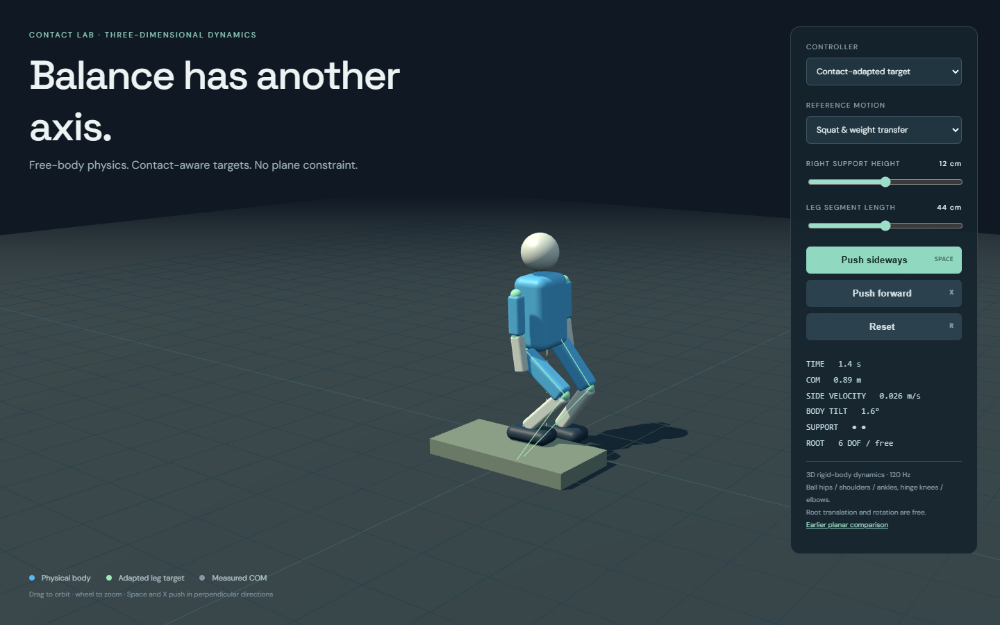
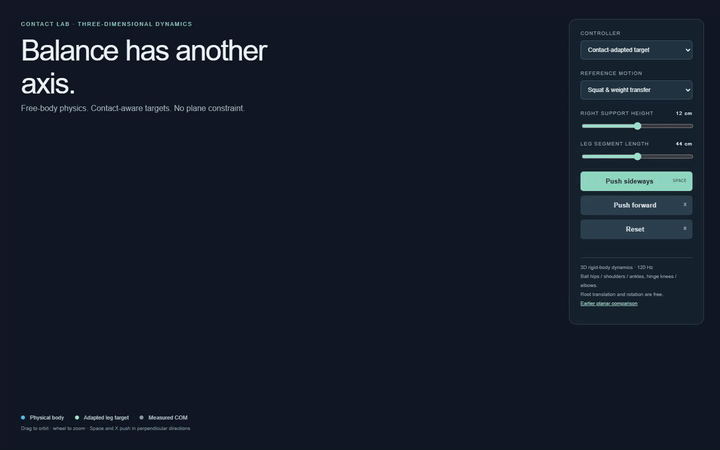

# Physical locomotion lab

An experimental physical-character stack developed for a Spawn/Cybr walking study. The current MuJoCo controller turns measured body state, support, terrain, and movement intent into finite joint effort. The root remains dynamic.

This source snapshot also includes the earlier, independently runnable Rapier contact experiments. The avatar and learned checkpoints are intentionally absent pending separate redistribution review. **This is a research work in progress, not a completed walking controller or a Spawn integration.**





These images show the actual **earlier procedural Rapier baseline**, not the newer MuJoCo actor. The GIF is an eight-second excerpt of an existing local recording, at its original timing. It demonstrates physical balance/response under the pictured conditions; it does not establish walking, sprinting, or traversal quality.

## Run the included browser baseline

Use Node.js 22.12 or newer and npm. Install the locked dependencies:

```sh
npm ci
npm run dev -- --port 5188
```

Open `http://127.0.0.1:5188/3d.html` for the full 3D procedural mannequin, or `/` for the planar comparison. Drag to orbit. Use the controller and motion selectors to compare contact-adapted, fixed, and passive behavior; adjust leg length or support height. Space applies a side push, X a forward push, and R resets the 3D experiment. Reset is a new experiment, not a recovery claim.

```sh
npm test
npm run test:3d
npm run build
```

The mechanical tests write results under the ignored `evidence/` directory. Build output is in `dist/`.

## MuJoCo runtime: additional inputs required

The `unified_runtime/` source is the recent 216-input / 28-output physical feedback candidate. It is supplied for inspection and continuation. It cannot reproduce the original avatar experiment from this repository alone.

You need:

- Python 3.12 and the packages in `requirements-mujoco.txt`.
- A separate [MimicKit](https://github.com/xbpeng/MimicKit) checkout. The inspected source used commit `fbe1a36e878f036d6bf5521defb8eb3b8ab4170d`. Follow its dependency instructions and set `MIMICKIT_ROOT` to the checkout root.
- A reviewed, compatible **216-input** actor state dict. Set `FOUNDATION_CHECKPOINT` to its local `.pt` path. No pretrained or adapted weights are distributed here. Only load checkpoints you trust.
- For the original browser avatar view at `/policy.html`, separately authorized `public/cybr-combat.glb`, `public/physical-contact-rig.json`, and the matching Basis transcoder assets in `public/basis/`. Those assets are not included; the policy view currently requires them.

Example PowerShell setup, after obtaining the separately licensed dependencies and checkpoint:

```powershell
python -m venv .venv
.\.venv\Scripts\Activate.ps1
python -m pip install -r requirements-mujoco.txt
$env:MIMICKIT_ROOT = 'C:\path\to\MimicKit'
python -m pip install -r "$env:MIMICKIT_ROOT\requirements.txt"
$env:FOUNDATION_CHECKPOINT = 'C:\path\to\reviewed-actor.pt'
$env:LOCOMOTION_COURSE = '0' # floor/circle; use 1 for the obstacle course
$env:LOCOMOTION_PORT = '5190'
python -m unified_runtime.serve
```

The server binds to loopback only (`127.0.0.1:5190`) and starts paused. Run Vite on port 5188 for its expected CORS origin. The browser sends intent to `/intent`; `/state` returns measured physical state. Port 5191 is supported for an independently started course instance. Do not attach this package to a live game or an existing training process.

## Architecture

```text
Browser controls or intent requests
                |
        policy/server.py (loopback transport)
                |
 unified_runtime/controller.py (one movement owner)
        /                   \
natural/goals.py       natural/coordinates.py
continuous intent     body + terrain + contact observations
        \                   /
         natural/actor.py (216 -> 28)
                |
 muscle/drive.py + muscle/control.py (finite joint effort)
                |
 terrain/body.py + motor/body.py (native MuJoCo contacts)
                |
        measured state and diagnostics
```

`support/bounded-humanoid.xml` is the bounded physical model; it is not the avatar mesh. `terrain/world.py` creates the real collision course and disturbance body. `foundation/` and `residual/` preserve the actor's observation/backbone contract. Inference does not play an animation clip or apply a root stabilizing force.

The separate browser baseline lives in `src/physics.js` and `src/physics3d.js`; its renderers read the physical state through `src/main.js` and `src/main3d.js`.

## Current status and limits

- The procedural baseline has mechanical checks for balance, reach, proportion changes, contact, and disturbances. These tests do not validate the MuJoCo locomotion policy.
- The recent MuJoCo candidate is **not accepted** as reliable walking/running. Existing review records report underspeed, incomplete braking/restart, unlearned crouch/jump/course behavior, and failures for some frontal disturbances.
- The physical body uses the upstream humanoid proportions; it is not calibrated to the original Cybr mesh anatomy.
- Training code, training data, checkpoints, mutable trials, private continuation notes, and historical experiment archives are not part of this runtime package.
- The avatar view is incomplete without separately supplied assets. Use the procedural baseline for the self-contained browser demo.

## Provenance and licensing

See [PROVENANCE.md](PROVENANCE.md) and [THIRD_PARTY_NOTICES.md](THIRD_PARTY_NOTICES.md). Existing `package.json` declares ISC; this preparation does not add or select a new license for the user's code. The upstream MimicKit notice is preserved for the derived humanoid model. Third-party dependencies retain their own licenses.
