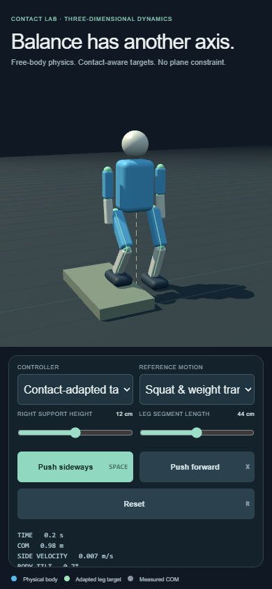
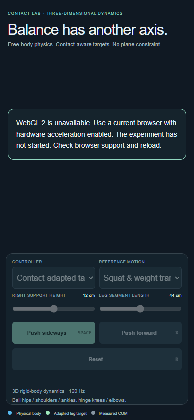

# Browser baseline portability evidence

The self-contained planar and 3D contact experiments share one browser startup guard and responsive viewport sizing. Simulation sources and the MuJoCo candidate are unchanged.

## Observed on 22 October 2026

- Windows, Node.js 22.17.1, npm 10.9.2: locked install and production build passed.
- The existing planar suite passed all 14 cases.
- A separate bounded 30-second 3D case passed with 24 N·s side and forward impulses, no fall, and 0.00000399 m maximum anchor separation.
- The full 27-case 3D sweep exceeded the local audit's 180-second budget. It is not counted as passed in this audit.
- The production browser check passed 10 checks in Chrome 145: planar and 3D at 1280×800, 390×844, 844×390 and 320×568, plus unavailable-WebAssembly and unavailable-WebGL-2 states. It verifies production resources, scrollable controls, push/reset and navigation.
- An initial hardware-browser run passed; a repeat timed out at startup. The final repeat used the same explicit SwiftShader software-rendering flags as CI and passed. GPU-driver reliability and physical phones are not certified.

The screenshots below are from that final desktop-browser software-rendering check. A phone-sized viewport is not a physical mobile-device test.

## CI and remaining limits

The workflow runs locked install, both mechanical suites, production build and browser checks on Windows, Linux and macOS. Those hosted jobs must run before cross-OS execution can be claimed. Local Windows evidence does not establish Linux/macOS success.

The MuJoCo runtime still needs separately supplied actor weights, MimicKit and reviewed avatar assets, as described in the main README. Browser fallback handling does not replace those inputs or establish walking quality.
